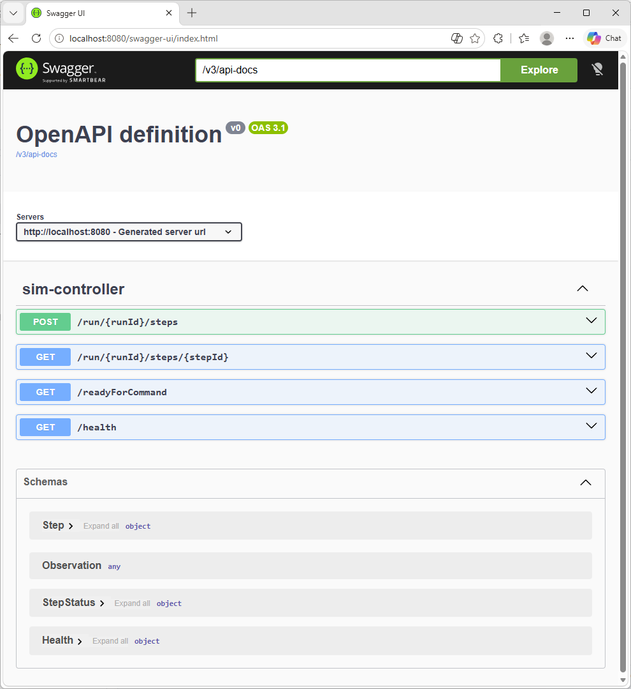
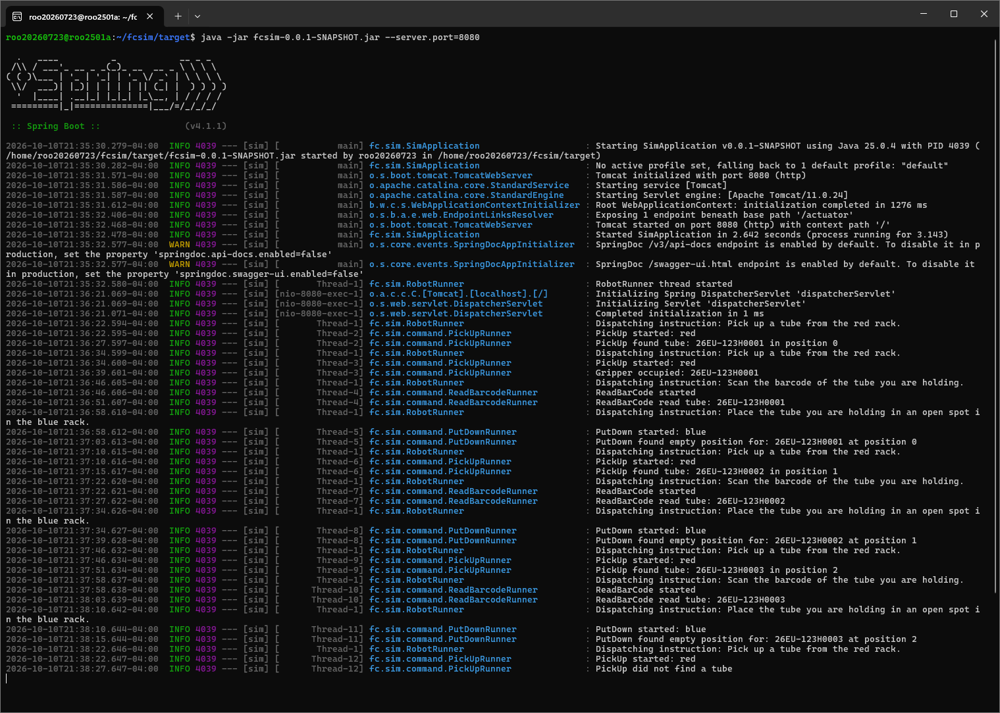
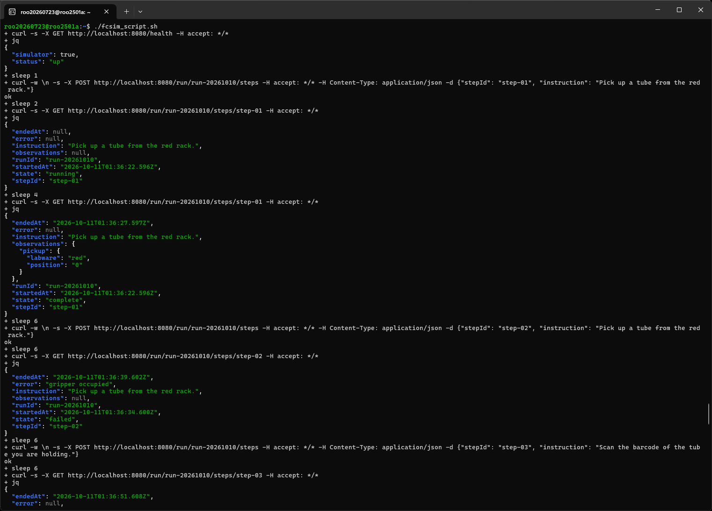

# fcsim

Build & Run Instructions (or use prebuilt JAR)

```
git clone https://github.com/ghsmith/fcsim
cd fcsim
mvn package
cd target
java -jar fcsim-0.0.1-SNAPSHOT.jar --server.port=8080
```

Swagger Endpoint Documentation at `swagger_ui.html`


Server Screenshot


Client Screenshot

