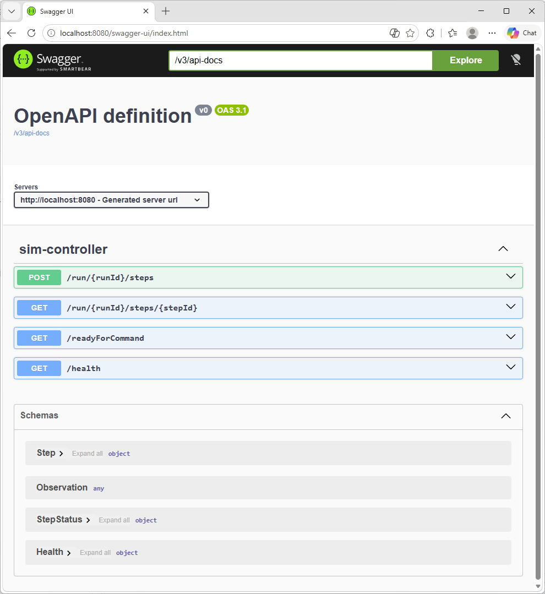
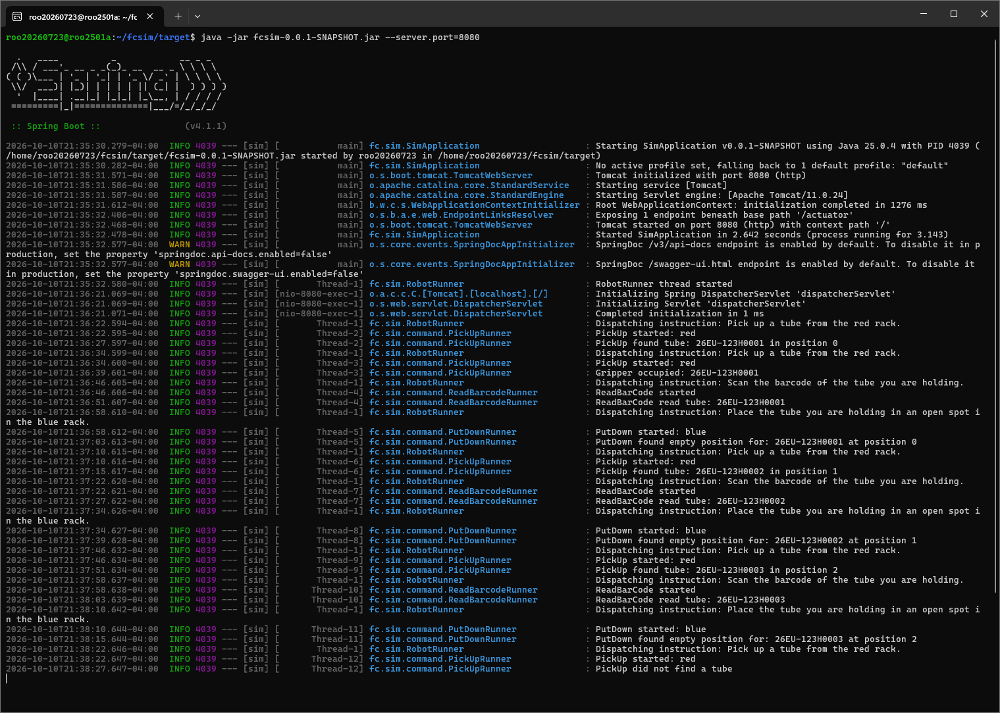
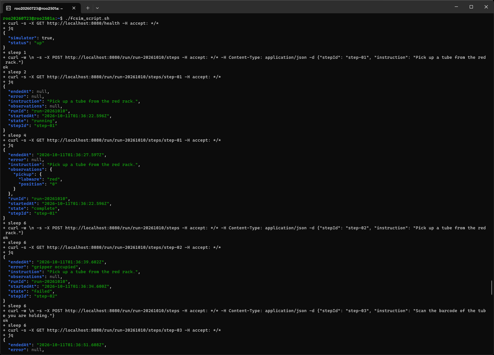
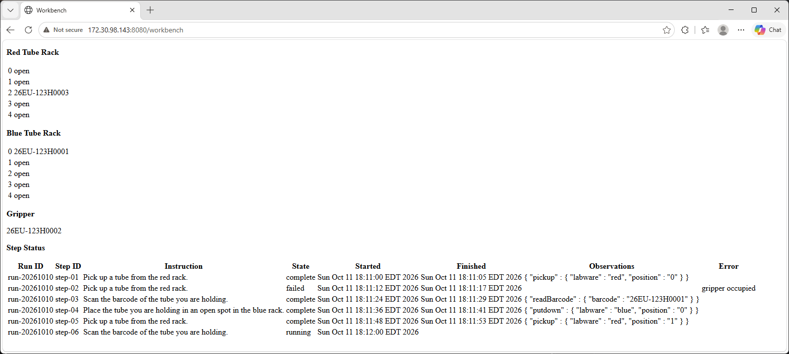

# fcsim

Build & Run Instructions (or use prebuilt JAR)

```
git clone https://github.com/ghsmith/fcsim
cd fcsim
mvn package
cd target
java -jar fcsim-0.0.1-SNAPSHOT.jar --server.port=8080
```

API (FlowConductor and GT Robot OS ICD v0.3, sections 4 to 6)

| Call | What it does |
| --- | --- |
| `GET /health` | `{"status": "up", "simulator": true}` |
| `POST /runs` `{"run_id"}` | Starts a run and resets the workbench (3 tubes in the red rack). HTTP 201, or 200 if the run exists. |
| `POST /runs/{run_id}/steps` `{"step_id", "instruction"}` | Sends one step (HTTP 202). The same `step_id` again is never run twice (HTTP 200). |
| `GET /runs/{run_id}/steps/{step_id}` | The step's status. |
| `POST /runs/{run_id}/cancel` | Stops the run and its running step. Safe to repeat. |

HTTP 400 for a malformed request, 404 for an unknown run or step, 409 for a step while another one is pending or running.

Steps, 5 s each: `Pick up a tube from the red rack.`, `Scan the barcode of the tube you are holding.`, `Place the tube you are holding in an open spot in the blue rack.`

```
{"step_id": "step-04", "state": "completed", "started_at": "2026-11-09T17:49:33Z", "ended_at": "2026-11-09T17:49:38Z",
 "observations": {"placed_at": {"labware": "blue rack", "position": "A1"}}, "detail": "Placed 26EU-123H0001 in blue rack A1.", "error": null}
```

- `state`: `pending`, `running`, `completed`, `failed` or `cancelled`.
- `observations`: `picked_from` after a pick, `barcode` after a scan, `placed_at` after a place. Spots are `A1` to `A5`.
- `error`, only when `failed`: `{"code", "arm_error_code": null, "message"}`. Codes: `UNKNOWN_INSTRUCTION`, `GRIPPER_OCCUPIED`, `GRIPPER_EMPTY`, `NO_TUBE_FOUND`, `RACK_FULL`, `UNKNOWN_LABWARE`.

Swagger Endpoint Documentation at `/swagger_ui.html`


Server Screenshot


Client Screenshot (taken before the ICD v0.3 calls; `fcsim_script.sh` has the current ones)


Workbench Viewer Screenshot at `/workbench`

